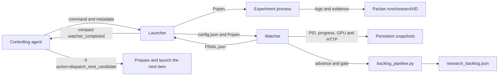

# Autonomous experiment watcher

This document describes the watcher implemented in
`tools/analysis/watch_experiment_processes.py` and its launcher in
`tools/analysis/launch_watched_experiment.py`. It is the operating reference
for running long jobs without losing the completion, the backlog state or the
recovery of the local services.

The research backlog (`config/research_backlog.json`) and the `runs/research/`
packets these tools operate on are the maintainer's raw records and are not
published in this repository; the paths below describe their layout.

## What it solves

The watcher ties together four things that could previously drift apart:

1. the physical experiment process;
2. the evidence packet in `runs/research/<ID>`;
3. the state machine of `backlog_pipeline.py`;
4. the controlling agent that must receive the completion and continue the queue.

The goal is not to decide whether a scientific hypothesis is correct. The goal
is to make sure the end of the process is observed and turned into an
unambiguous operational state, with persistent evidence and fail-closed
behavior.

## Guarantees and limits of authority

The watcher may:

- observe whether the PID still exists on the host;
- count physical progress markers in the packet;
- record GPU telemetry and HTTP availability;
- require a `raw/receipt.json` before accepting the run;
- perform the legal transition `IMPLEMENTED -> EXECUTED`;
- idempotently accept a packet that is already `EXECUTED`;
- run the pipeline's global gate;
- wait up to 180 seconds for the final HTTP recovery;
- recompute the backlog states and the next candidate;
- wake the controlling agent with a compact completion message.

The watcher may not:

- audit the scientific content of the receipt;
- write `REVIEW.json`;
- move a packet to `VERIFIED`, `PROMOTED` or `REJECTED`;
- weaken gates or correct raw evidence;
- choose an experiment command from the returned ID alone;
- start the next candidate automatically;
- restore services on its own;
- infer success only because the process ended quickly.

The executor remains responsible for producing evidence and restoring the
environment. The independent auditor remains responsible for checking the
science.

### Inherited CPU limit in WSL

On the maintainer's GPU node, WSL exposes 24 vCPUs, but the systemd default
policy limits ordinary processes and their descendants to 20.
`llm-inference.service` is the only exception and gets all 24. The restriction
lives in WSL, not only on the Python PID the watcher launches, because the real
runners open independent WSL subprocesses.

Before a CPU-sensitive experiment there, the maintainer runs
`python tools/analysis/wsl_cpu_policy.py --json` and requires `ok=true`. That
checker and the systemd drop-ins it verifies are specific to that machine and
are not published in this repository.

### Frugal harness terminal (opt-in)

New runners can use `src/model_lifecycle/experiment_harness.py` and produce
`raw/run.terminal.json`. A verified `SEALED` terminal replaces the legacy
inference based on `progress_glob`; `ABORTED`, a diverging hash or a malformed
terminal stop the flow without a scientific transition. The legacy mode stays
accepted during the migration, except when the launcher gets
`--require-harness-terminal`.

The terminal does not turn the watcher into an auditor. It proves
self-consistency, not authenticity against a malicious executor: the external
anchor is still the independent review. The watcher also requires `RESULT.md`,
matching identity across the configuration, `PIPELINE.json`, receipt and
terminal, and an atomic receipt with the worker's real exit code. When
restoration is required, it must appear as a successful event before the seal.
The final compact output includes `audit_ready_ids` so the controller hands the
`EXECUTED` packets to the independent auditor.

In this mode `--progress-glob` and `--expected-progress` are optional: the
launcher uses the terminal itself as the visible marker. Legacy runners must
still declare both arguments.

## Components

| Component | Responsibility |
|---|---|
| `launch_watched_experiment.py` | Starts the experiment, starts the watcher, records the link between them and, by default, keeps the controlling session waiting for the watcher. |
| `watch_experiment_processes.py` | Polls PIDs, progress, pipeline, GPU and endpoints; finalizes the packets and writes the monitoring result. |
| `backlog_pipeline.py` | The only authority for manifest transitions and for the global gate. |
| `smoke_experiment_mode.py` | Runs a temporary, non-mutating canary through the whole launcher-watcher-queue path. |
| `tests/test_watch_experiment_processes.py` | Exercises the watcher and the launcher with isolated fixtures and simulated PIDs and pipeline. |

## Architecture



The launcher stays in the foreground waiting for the watcher, not for the
experiment process. The watcher is what observes the process. That link is the
mechanism that brings the completion back to the agent's session.

## Full flow

### 1. Preconditions

Before launch, the packet must be `IMPLEMENTED`, with:

- a frozen preregistration;
- the implementation recorded and hash-bound in `PIPELINE.json`;
- a known packet directory;
- a clear physical progress contract;
- the complete experiment command.

The watcher neither prepares nor preregisters the packet.

### 2. Experiment launch

The launcher first confirms that the task and directory match the backlog's
canonical packet and that the manifest and `PIPELINE.json` agree on
`IMPLEMENTED`; otherwise it writes `LAUNCH_FAILED.json` with
`phase=packet_validation` and returns code 2. Then it creates, in exclusive
mode:

- `runs/research/<ID>/runner.stdout.log`;
- `runs/research/<ID>/runner.stderr.log`.

If either log already exists, the launcher keeps both, writes
`LAUNCH_FAILED.json` with `phase=log_initialization` and requires a new
attempt. Then it starts the command with the repository as the working
directory. On Windows it uses `CREATE_NEW_PROCESS_GROUP | CREATE_NO_WINDOW`; on
POSIX it creates a new session. So an early watcher failure or a timeout ends
the worker's tree, not only its parent process.

If the experiment cannot be started, the launcher writes `LAUNCH_FAILED.json`
with `phase=experiment_spawn` and returns code 2.

### 3. Watcher launch

With the experiment's real PID, the launcher writes `config.json` and starts the
watcher in another process. If that second spawn fails, the launcher ends the
experiment so that no orphan job runs unmonitored, writes `LAUNCH_FAILED.json`
with `phase=watcher_spawn` and returns code 2.

### 4. Polling

For each experiment the watcher checks:

- whether the PID exists;
- progress according to the explicit `progress_mode` + `progress_glob` contract;
- the stage in `PIPELINE.json`;
- the GPU through `nvidia-smi`;
- the HTTP status of the configured endpoints.

The launcher's default is 300 seconds; a direct configuration without
`poll_seconds` uses 15. The minimum accepted is 5 seconds.

`progress_mode=files` counts matching files. `progress_mode=jsonl_lines` counts
non-empty lines in the matching JSONL files. Never use the file count to stand
for samples: a `samples.jsonl` with 448 lines counts 1 in `files` and 448 in
`jsonl_lines`.

`WATCH_STATUS.json` is updated every cycle. A `progress` event is appended to
`events.jsonl` only when at least one of these fields changes:

- PID alive/dead;
- progress count;
- pipeline stage.

Changes only in the GPU or an endpoint show up in the latest snapshot but do not
add a progress line. This reduces I/O, noise and token use.

### 5. Detecting the end

When the worker ends, the launcher reaps the process and writes
`WORKER_EXIT.json` atomically. The watcher then:

1. requires an integer exit code of zero, with no timeout or earlier watcher failure;
2. requires `raw/receipt.json`, `RESULT.md` and a valid terminal;
3. binds `task_id`, PID and `run_id` to the exit receipt;
4. binds the task, `PIPELINE.json`, receipt and terminal;
5. confirms that the packet is the backlog's canonical `packet_dir` and that the states agree;
6. accepts the stage `IMPLEMENTED` or, idempotently, `EXECUTED`;
7. at `IMPLEMENTED`, calls `backlog_pipeline.py advance <ID> --to EXECUTED`;
8. confirms the final stage and runs `backlog_pipeline.py gate`.

Temporary canaries need `--unmanaged-canary`: they are validated but neither
change the backlog nor appear in `audit_ready_ids`.

### 6. Final recovery

After every process has ended, the watcher tests the endpoints again. If one
does not return HTTP 200, it waits in 5-second cycles for up to
`service_settle_seconds`, which the launcher sets to 180 seconds.

This check tests HTTP availability, not the full identity of the service. An
experiment that interrupts serving must record in its own receipt the initial
and final identity, PIDs, arguments, restarts and the health of 8081.

### 7. Queue update

The watcher runs:

```powershell
python tools/analysis/backlog_pipeline.py rebalance --apply --actor <actor> --json
python tools/analysis/backlog_pipeline.py status --json
python tools/analysis/backlog_pipeline.py next --json
```

The first command runs only in `--experiment-mode`, only when every experiment
finished valid, and applies only strategic assessments already explicit in the
canonical policy. The watcher does not score results or change scientific
state. It persists only the policy digest, counts and affected IDs; the full
explanation remains available through `backlog_pipeline.py rank --explain` and
[`BACKLOG_PRIORITY_POLICY.md`](BACKLOG_PRIORITY_POLICY.md).

In `--experiment-mode`, a failure to recompute the queue turns the completion
into an alert. The final snapshot includes counts per state and the full object
of the next candidate, when there is one.

### 8. Handing over to the controller

In the default mode, the launcher waits for the watcher and prints only two
compact JSON objects:

```json
{"event":"watcher_started","task_id":"BACKLOG-X","watch_id":"WATCH-X","poll_seconds":300}
{"event":"watcher_completed","task_id":"BACKLOG-X","status":"complete","action":"dispatch_next_candidate","next_id":"BACKLOG-Y","continuation_id":null,"audit_ready_ids":["BACKLOG-X"]}
```

The second object wakes the controlling session. `dispatch_next_candidate` is an
instruction to the agent, not an already launched subprocess. The agent still
has to:

1. check the candidate and its dependencies;
2. prepare the right command;
3. launch the next experiment with another watcher.

This keeps a generic monitor from inventing arguments, running an item that is
not prepared yet or exceeding the authority it was given.

## Recommended command

```powershell
python tools/analysis/launch_watched_experiment.py `
  --task-id BACKLOG-EXAMPLE-01 `
  --packet-dir runs/research/BACKLOG-EXAMPLE-01 `
  --progress-glob "raw/finalized/*.json" `
  --progress-mode files `
  --expected-progress 4 `
  --watch-id EXPERIMENT-WATCH-2026-08-27-EXAMPLE-R1 `
  --watch-outdir runs/autonomous/EXPERIMENT-WATCH-2026-08-27-EXAMPLE-R1 `
  --experiment-mode `
  -- `
  python tools/research/run_example.py `
  --outdir runs/research/BACKLOG-EXAMPLE-01
```

The `--` separator marks the start of the experiment command.

For progress stored as records in a single JSONL file, use
`--progress-mode jsonl_lines` and keep `--expected-progress` in the same unit.

## Frozen autonomous waves

An authorized long chain should not depend on the agent interpreting
`dispatch_next_candidate` at the exact moment of completion. Prepare all the
packets in `IMPLEMENTED`, freeze the argv and progress contracts in a
`local-labs-watched-wave-v1` manifest and hand the sequence to
`tools/analysis/run_watched_experiment_wave.py`.

```json
{
  "schema": "local-labs-watched-wave-v1",
  "wave_id": "WAVE-2026-08-29-A",
  "poll_seconds": 300,
  "items": [
    {
      "task_id": "BACKLOG-A",
      "command": ["python", "tools/research/run_a.py"],
      "progress": {
        "mode": "jsonl_lines",
        "glob": "raw/samples.jsonl",
        "expected": 448
      }
    },
    {
      "task_id": "BACKLOG-B",
      "command": ["python", "tools/research/run_b.py"],
      "require_harness_terminal": true
    }
  ]
}
```

```powershell
python tools/analysis/run_watched_experiment_wave.py `
  --manifest config/research_trails/WAVE-2026-08-29-A.json `
  --outdir runs/autonomous/WAVE-2026-08-29-A
```

The supervisor runs only the frozen argv, in order. The next item starts only
after `FINAL.json.status=complete`, presence in `audit_ready_ids` and `EXECUTED`
agreement between the backlog and the packet. The state and the manifest digest
are persisted. Resuming skips items already validated and recovers the crash
window between the watcher writing `EXECUTED` and the supervisor recording the
completion. Any alert stops the wave. The supervisor does not create
hypotheses, does not promote, does not commit and does not push.

### Launcher arguments

| Argument | Required | Meaning |
|---|---:|---|
| `--task-id` | yes | Exact ID in the backlog. |
| `--packet-dir` | yes | Experiment packet, relative to the repository or absolute. |
| `--progress-glob` | legacy | Glob relative to the packet; optional with a required terminal. |
| `--progress-mode` | no | `files` (default) or `jsonl_lines`. |
| `--expected-progress` | legacy | Minimum number of markers; optional with a required terminal. |
| `--require-harness-terminal` | no | Requires a verified terminal, receipt, `RESULT.md`, identity and exit code. |
| `--unmanaged-canary` | no | Runs an explicit temporary canary without a backlog transition or audit handoff. |
| `--watch-id` | yes | Unique identity of this observation. |
| `--watch-outdir` | yes | Persistent watcher directory. Must be unique per attempt. |
| `--poll-seconds` | no | Cadence; default 300, effective minimum 5. |
| `--max-runtime-seconds` | no | Hard worker deadline; default 86400 (24 hours). |
| `--experiment-mode` | no | Makes queue validity part of the completion and computes the follow-up action. |
| `--verbose-controller-output` | no | Prints the full metadata on the controller's stdout. |
| `--detach-watcher` | no | Legacy only; refused when the harness terminal is required. |

## Progress marker contract

`progress_glob` does not measure a percentage and does not interpret content. It
counts matches. Therefore:

- a marker must stand for a unit that is really finished;
- write the content to a temporary file and rename it atomically when possible;
- do not reuse names across units;
- do not create markers before validating the matching output;
- choose `expected_progress` so that a partial run does not pass;
- prefer a final `complete.json` marker written after `RESULT.md` and the
  receipt when the runner allows that contract.

Example for two checkpoints:

```text
raw/finalized/checkpoint_seed_1.json
raw/finalized/checkpoint_seed_2.json
```

With `--expected-progress 2`, a single finished checkpoint yields
`failed_incomplete_progress`.

## Persisted artifacts

### In the experiment packet

| File | Content |
|---|---|
| `runner.stdout.log` | Full stdout of the experiment command. |
| `runner.stderr.log` | Full stderr of the experiment command. |
| `raw/receipt.json` | Canonical receipt produced by the runner. |
| `RESULT.md` | Bounded summary from the executor. |
| files matched by `progress_glob` | Markers of finished units. |

The launcher creates both runner logs in exclusive mode (`x`) and refuses to
start when either already exists, so a repeat in the same packet never
overwrites them. Attempts that need separate logs use successor packets.

### In the watcher directory

| File | Persistence and purpose |
|---|---|
| `config.json` | Configuration actually handed to the watcher. |
| `LAUNCH.json` | PIDs, command, paths and the kind of link to the controller. |
| `LAUNCH_FAILED.json` | Validation or spawn failure, when the experiment or watcher does not start. |
| `WATCH_STATUS.json` | Current snapshot, overwritten atomically through `.tmp` + replace. Includes `final` after the end. |
| `events.jsonl` | Append-only lines for the start, changes, the end of each experiment and the end of the watcher. |
| `FINAL.json` | Final operational decision, written atomically. |
| `watcher.stdout.log` | The watcher's internal stdout. Usually empty. |
| `watcher.stderr.log` | The watcher's internal traceback or diagnostics. |

Use a new `watch-id` and `watch-outdir` for every attempt. Reusing the same
directory mixes the append-only `events.jsonl` and overwrites other metadata.

## Internal experiment states

| State | Meaning |
|---|---|
| `watching` | The PID is still under observation. |
| `executed_valid` | Receipt and progress exist, the transition ended in `EXECUTED` and the gate passed. |
| `completed_unmanaged` | A temporary `--unmanaged-canary` run finished valid, without a backlog transition. |
| `failed_pid_never_observed` | The PID no longer existed when the watcher first managed to observe it. |
| `failed_worker_timeout` | The worker passed its hard deadline. |
| `failed_no_worker_exit` / `failed_invalid_worker_exit` / `failed_worker_exit` | The exit receipt is missing, invalid, or reports a non-zero exit. |
| `failed_no_harness_terminal` / `failed_invalid_harness_terminal` / `failed_harness_aborted` | A required harness terminal is missing, invalid or `ABORTED`. |
| `failed_identity_mismatch` | Task, packet, receipt, terminal and worker identities disagree. |
| `failed_noncanonical_packet` | The packet is not the backlog's canonical `packet_dir`. |
| `failed_no_receipt` | The process ended without a receipt. |
| `failed_no_result` | The process ended without `RESULT.md`. |
| `failed_incomplete_progress` | A receipt exists, but markers are missing. |
| `failed_validation` | The stage, the advance or the gate did not validate. |

The global status is:

- `complete`: every item is `executed_valid` (or `completed_unmanaged`), the
  final gate passes, the endpoints return 200 and, in experiment mode, the queue
  was read correctly;
- `complete_with_alert`: any of those conditions failed.

The watcher exits with code 0 for `complete` and 2 otherwise.

## Completion actions

| Condition | `completion_action` |
|---|---|
| `complete`, experiment mode and there is a candidate | `dispatch_next_candidate` |
| `complete`, experiment mode, no candidate, but an unresolved `IMPLEMENTED` item | `dispatch_implemented_candidate` |
| `complete`, experiment mode, no candidate, but an unresolved `EXECUTED` item | `dispatch_audit_candidate` |
| `complete`, experiment mode, no candidate, but an unresolved `BLOCKED` item | `resolve_blocked_candidate` |
| `complete`, experiment mode, no candidate and nothing unresolved | `notify_queue_empty` |
| `complete`, without experiment mode | `notify_completion` |
| `complete_with_alert` | `inspect_alert_before_dispatch` |
| status outside the expected final domain | `stop_fail_closed` |

The unresolved item is reported as `continuation_candidate` (`continuation_id`
in the compact output). No alert allows automatic dispatch.

## Failure matrix

| Failure | Code/state | Effect |
|---|---|---|
| Packet or logs fail validation | launcher 2, `LAUNCH_FAILED` | Nothing is started. |
| Experiment does not start | launcher 2, `LAUNCH_FAILED` | The watcher is not started. |
| Watcher does not start | launcher 2, `LAUNCH_FAILED` | The experiment is ended so it does not run orphaned. |
| PID never observed | `failed_pid_never_observed` | The packet is not finalized. |
| Receipt missing | `failed_no_receipt` | The state does not advance. |
| Insufficient progress | `failed_incomplete_progress` | The state does not advance. |
| Unexpected stage | `failed_validation` | Stops fail-closed. |
| `advance` fails | `failed_validation` | Keeps the evidence and does not dispatch the next item. |
| Gate fails | `failed_validation` or global alert | Does not dispatch the next item. |
| Endpoint does not recover in 180 s | `complete_with_alert` | Requires inspection. |
| Invalid queue in experiment mode | `complete_with_alert` | Does not dispatch the next item. |
| `FINAL.json` missing/invalid | launcher 3 if the watcher exited 0 | The controller gets an explicit failure. |

In a configuration with several experiments, a single invalid item makes the
global result `complete_with_alert`, even though the others may end as
`executed_valid`.

## Foreground and detached modes

### Foreground, recommended

This is the default. The launcher ends only after the watcher and hands
`watcher_completed` to the controller. It is the required option when the agent
is expected to be told and to continue the queue.

### Detached

`--detach-watcher` returns right after both processes start. Observation goes on
on disk, but nothing is actively delivered to the original session. The
launcher prints an explicit warning:

```text
WARNING: watcher detached; completion will only be persisted on disk and will not wake the controlling session.
```

Use it only for legacy runners when another external supervisor reads
`FINAL.json`. The `--require-harness-terminal` mode requires the foreground so
that the launcher reaps the child process and persists its exit code without the
ambiguity of zombie processes in WSL.

## Saving tokens and noise

The current design reduces use in three ways:

1. a default polling interval of five minutes;
2. events only when the progress signature changes;
3. controller stdout limited to the compact start and end events.

Details stay on disk. For human follow-up, read only the fields you need from
`WATCH_STATUS.json`; do not dump `events.jsonl`, the runner logs and the full
telemetry on every poll.

Use `--verbose-controller-output` only to diagnose a launch or an integration.

## Direct configuration with several experiments

The watcher accepts several items in `experiments`, although the public launcher
creates a configuration with exactly one item. A direct configuration has this
shape:

```json
{
  "schema": "local-labs-experiment-watch-v1",
  "watch_id": "WATCH-BATCH-01",
  "experiment_mode": true,
  "poll_seconds": 300,
  "service_settle_seconds": 180,
  "experiments": [
    {
      "task_id": "BACKLOG-A",
      "pid": 1234,
      "packet_dir": "runs/research/BACKLOG-A",
      "progress_glob": "raw/finalized/*.json",
      "expected_progress": 2
    },
    {
      "task_id": "BACKLOG-B",
      "pid": 5678,
      "packet_dir": "runs/research/BACKLOG-B",
      "progress_glob": "raw/finalized/*.json",
      "expected_progress": 4
    }
  ],
  "final_health_urls": [
    "http://127.0.0.1:8080/health",
    "http://127.0.0.1:8081/health"
  ],
  "actor": "Codex executor watcher"
}
```

Direct run:

```powershell
python tools/analysis/watch_experiment_processes.py `
  path/to/config.json `
  --outdir runs/autonomous/WATCH-BATCH-01
```

In this mode, whoever created the PIDs is responsible for avoiding unwatched
jobs if the watcher fails to start. The launcher is safer for the common case.

## Tests

### Isolated fixtures

```powershell
python -m pytest tests/test_experiment_harness.py tests/test_watch_experiment_processes.py -q
```

The suite collects 139 cases: 56 for the harness and 83 for the watcher and
launcher. It covers:

- detection of a live and of a missing PID;
- healthy HTTP and transport errors;
- parsing of GPU telemetry, including errors and unexpected output;
- missing and present stage;
- the full matrix of completion actions;
- a clean advance and idempotence at `EXECUTED`;
- a missing receipt and incomplete progress;
- a PID never observed;
- an unexpected stage, an advance failure and a gate failure;
- an unavailable service and recovery before the deadline;
- a mixed batch and processes ending at different times;
- invalid JSON from the pipeline;
- a queue update failure;
- foreground and detached launcher;
- a spawn failure in each phase;
- a missing or invalid `FINAL.json`;
- staged termination of the orphan job's group/tree, including a real child process;
- refusal without truncating pre-existing logs, and explicit requirement of the tree mode;
- refusal of a packet outside `IMPLEMENTED` before the logs are created;
- `SEALED`, `ABORTED`, missing, malformed and post-seal-altered terminals;
- a short process completed through the terminal, without depending on an earlier observation of the PID;
- compact delivery of `audit_ready_ids` and an opt-in launcher without redundant markers;
- a non-zero exit code after the seal, timeout, POSIX zombie and an invalid exit receipt;
- the identity link between task, packet, receipt, terminal and worker;
- semantic re-hash tampering of the journal and reserved names in subdirectories.

The fixtures use a temporary repository, a stubbed pipeline, controlled PIDs and
no sleeps. They run no models and do not change the real backlog.

### Live non-mutating canary

```powershell
python tools/analysis/smoke_experiment_mode.py
```

The canary needs the private research backlog, so it only runs in the
maintainer's checkout. It:

- computes the backlog's SHA-256 before and after;
- creates the packet, receipt and marker only in a temporary directory;
- goes through the foreground launcher and the real watcher;
- uses 5-second polling to fit the canary's timeout;
- requires delivery of `watcher_completed`;
- requires a complete `FINAL.json`;
- requires a valid queue refresh;
- confirms that the backlog did not change.

It tests integration and delivery, not scientific validity or GPU work.

### Reproducible mutation

```powershell
python tools/analysis/mutation_test_experiment_harness.py
```

The gate runs 76 semantic mutants on temporary copies, fails if any survives or
if a substitution does not find exactly one operator, and writes the full report
to the path given by `--output` (default
`runs/benchmarks/HARNESS-MUTATION-2026-08-28/report.json`).

## Operational diagnostics

### Compact state

```powershell
$status = Get-Content runs/autonomous/<WATCH-ID>/WATCH_STATUS.json -Raw | ConvertFrom-Json
$status.experiments | Select-Object task_id,process_alive,progress,expected_progress,pipeline_stage,watch_status
$status.gpu
$status.health
```

### Completion

```powershell
Get-Content runs/autonomous/<WATCH-ID>/FINAL.json
```

### Relevant events

```powershell
Get-Content runs/autonomous/<WATCH-ID>/events.jsonl | Select-Object -Last 10
```

### Job logs

```powershell
Get-Content runs/research/<BACKLOG-ID>/runner.stdout.log -Tail 100
Get-Content runs/research/<BACKLOG-ID>/runner.stderr.log -Tail 100
```

### Process and GPU

```powershell
Get-Process -Id <PID> -ErrorAction SilentlyContinue
nvidia-smi
```

## Known limitations

- The watcher handles Windows and POSIX/WSL processes, including zombies, but
  legacy detached runners do not have the strong exit-code link of the
  foreground mode.
- A manual watcher without `worker_exit_path` keeps the legacy PID and progress
  contract; it must not be used for new harness runners.
- Local hashes prove self-consistency, not authenticity against a malicious
  executor; that authority stays with the independent audit.
- There is a residual risk of PID reuse in legacy configurations; in the new
  mode, `run_id`, PID, task and exit receipt must agree.
- The GPU parser assumes the output of a single GPU with five fields. On a
  multi-GPU host the output may only be kept as `raw`.
- Final health means HTTP 200. Semantic content and service identity belong to
  the experiment's receipt.
- The launcher fixes the endpoints 8080 and 8081. Only a direct configuration can
  supply another list.
- The `config.json` schema is an operational contract; it does not go through a
  separate JSON Schema validator today, and missing keys can end the watcher
  with a traceback.
- `dispatch_next_candidate` does not run the next item; it depends on an active
  controlling agent.
- The launcher supports one experiment per call. Several experiments need a
  direct configuration and extra lifecycle discipline.

## Operator checklist

Before:

- [ ] packet in `IMPLEMENTED`;
- [ ] pipeline gate passing;
- [ ] runner and arguments checked;
- [ ] `progress_glob` and `expected_progress` stand for complete work;
- [ ] unique `watch-id` and directory;
- [ ] known baseline for 8080/8081 and the GPU.

During:

- [ ] foreground launcher still linked;
- [ ] PID observed alive;
- [ ] progress grows at the expected milestones;
- [ ] no noisy reads below the needed cadence.

After:

- [ ] `FINAL.json.status == complete`;
- [ ] individual state `executed_valid`;
- [ ] packet in `EXECUTED`;
- [ ] global gate passing;
- [ ] final endpoints HTTP 200;
- [ ] `completion_action` handled by the controller;
- [ ] packet handed to an independent auditor, with no self-promotion.
